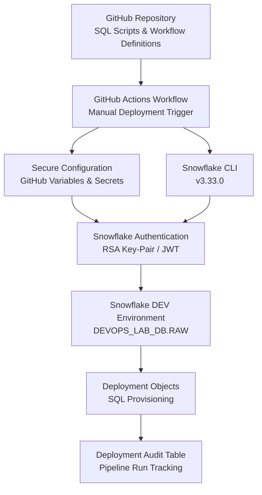

# Module 05 – Snowflake CI/CD with GitHub Actions

## Learning Progress

### Implementation Completed

This module focuses on implementing an automated CI/CD pipeline for Snowflake using GitHub Actions and Snowflake CLI, with a DevOps-oriented approach to deployment automation, secure authentication, configuration management, and deployment traceability.

The following components have been successfully implemented:

- **GitHub Actions Integration:** Configured GitHub Actions workflows to automate Snowflake connectivity testing and SQL deployment.
- **Secure Authentication:** Implemented RSA key-pair authentication for a Snowflake service user, eliminating the need for interactive username/password authentication in CI/CD pipelines.
- **Secrets Management:** Configured GitHub repository secrets to securely store the encrypted private key and its passphrase.
- **Configuration Management:** Used GitHub repository variables to manage Snowflake account, service user, role, warehouse, database, and schema configuration.
- **Snowflake CLI Integration:** Integrated Snowflake CLI v3.33.0 into GitHub Actions workflows for executing SQL scripts against Snowflake.
- **Automated SQL Deployment:** Created and executed SQL deployment scripts through GitHub Actions to provision Snowflake objects in the DEV environment.
- **Deployment Tracking:** Implemented a deployment tracking table to capture application name, deployment environment, deployment timestamp, deploying user, and pipeline execution ID.
- **Deployment Audit:** Implemented SQL-based audit logging using `MERGE` to record pipeline deployment information and support idempotent audit updates.
- **Pipeline Verification:** Successfully executed the deployment workflow and verified the deployment records directly in Snowflake.

---

## Current Deployment Architecture

The current implementation establishes an automated deployment path from source control to Snowflake DEV, with deployment execution and audit tracking.



### Architecture Components

| Component | Responsibility |
|---|---|
| GitHub Repository | Source control for SQL deployment scripts, workflow definitions, and documentation |
| GitHub Actions | Orchestrates the deployment workflow and execution of pipeline steps |
| GitHub Repository Variables | Stores non-sensitive Snowflake connection and deployment configuration |
| GitHub Secrets | Stores sensitive authentication materials such as private key and passphrase |
| Snowflake CLI | Provides command-line connectivity and SQL execution capabilities |
| Snowflake Service User | Enables non-interactive pipeline authentication |
| RSA Key-Pair Authentication | Secures authentication using JWT-based authentication |
| Snowflake DEV | Target environment for automated SQL deployment |
| Deployment Audit Table | Maintains deployment execution metadata and pipeline traceability |

---

## Deployment Workflow

The deployment workflow currently consists of the following stages:

### 1. Workflow Trigger

The deployment workflow is initiated manually using GitHub Actions `workflow_dispatch`.

This provides controlled execution of the DEV deployment pipeline while the deployment process is being developed and validated.

### 2. Source Checkout

GitHub Actions checks out the repository containing the deployment SQL scripts and workflow definitions.

Repository checkout is configured with restricted permissions.

### 3. Snowflake CLI Setup

The pipeline installs Snowflake CLI version `3.33.0` using the Snowflake GitHub Action.

This CLI is used to execute SQL scripts against the target Snowflake environment.

### 4. Secure Authentication

The workflow retrieves the required authentication configuration from GitHub Actions variables and secrets.

Authentication is performed using:

- Snowflake service user
- RSA private key
- JWT authentication
- Configured Snowflake role

No interactive authentication is required during pipeline execution.

### 5. SQL Deployment

The pipeline executes the SQL deployment scripts using Snowflake CLI.

The current deployment provisions the GitHub Actions deployment tracking table in the Snowflake DEV environment.

### 6. Deployment Audit

After the deployment execution, the pipeline executes the audit SQL script.

The audit process records:

- Application name
- Deployment environment
- Deployment user
- Deployment timestamp
- GitHub Actions pipeline run ID

The pipeline run ID provides a correlation identifier between the GitHub Actions execution and the corresponding Snowflake deployment record.

### 7. Deployment Verification

The deployment was successfully executed through GitHub Actions and the resulting audit records were verified in Snowflake.

---

## Snowflake Objects

### Deployment Tracking Table

**Object:** `GITHUB_ACTIONS_DEPLOYMENT`

**Location:**

`DEVOPS_LAB_DB.RAW.GITHUB_ACTIONS_DEPLOYMENT`

The table is designed to capture deployment metadata associated with the GitHub Actions pipeline.

| Column | Description |
|---|---|
| `DEPLOYMENT_ID` | Unique deployment record identifier |
| `APPLICATION_NAME` | Application or repository associated with the deployment |
| `ENVIRONMENT` | Target deployment environment |
| `DEPLOYED_BY` | Snowflake user executing the deployment |
| `DEPLOYED_AT` | Deployment timestamp |
| `PIPELINE_RUN_ID` | GitHub Actions execution identifier |

### Audit Strategy

The audit SQL script uses a `MERGE` operation based on the pipeline run ID.

This provides the foundation for idempotent audit processing and helps prevent duplicate audit records when the same pipeline execution is processed again.

---

## Security Implementation

The current implementation follows basic CI/CD security principles:

- Dedicated Snowflake service user for pipeline authentication.
- RSA key-pair authentication instead of interactive credentials.
- Sensitive authentication materials stored in GitHub Secrets.
- Non-sensitive configuration maintained using GitHub repository variables.
- Restricted GitHub workflow permissions.
- Private key material is not committed to the repository.
- Deployment execution uses a dedicated Snowflake role.

---

## Repository Structure

```text
05-snowflake-github-actions/
├── README.md
├── docs/
├── sql/
│   ├── 01_create_github_actions_deployment.sql
│   └── 02_record_github_actions_deployment.sql
└── scripts/
```

---

## Current Status

**DEV deployment automation: Successfully implemented and tested.**

The pipeline has successfully authenticated to Snowflake, executed SQL deployment scripts, and recorded deployment metadata in the Snowflake audit table.

---

## Next Implementation Roadmap

### Phase 1 – Deployment Reliability

- Implement post-deployment verification.
- Add automated SQL execution validation.
- Implement failure handling and meaningful error reporting.
- Add deployment status tracking.
- Validate deployment outcomes automatically.

### Phase 2 – CI Validation

- Implement SQL validation before deployment.
- Introduce pull-request validation workflows.
- Add linting and code quality checks.
- Prevent invalid SQL changes from reaching deployment stages.

### Phase 3 – Reusable CI/CD Architecture

- Create reusable GitHub Actions workflows.
- Separate deployment logic from application-specific workflows.
- Introduce workflow inputs and configurable deployment parameters.
- Standardize deployment workflows across repositories.

### Phase 4 – Environment Promotion

- Introduce DEV, QA, and PROD deployment configurations.
- Implement environment-specific configuration.
- Configure GitHub Environments.
- Introduce environment protection rules and approval gates.
- Implement controlled promotion between environments.

### Phase 5 – Enterprise Security

- Strengthen Snowflake RBAC for deployment automation.
- Evaluate environment-scoped secrets and configuration.
- Implement least-privilege deployment permissions.
- Improve secret rotation strategy.
- Evaluate integration with enterprise secrets management platforms.

### Phase 6 – Production Readiness

- Implement rollback and recovery strategies.
- Improve deployment observability.
- Establish deployment history and reporting.
- Implement concurrency controls.
- Develop standardized deployment templates for multiple teams.

---

## Learning Objective

The objective of this module is to evolve a basic Snowflake SQL deployment pipeline into an enterprise-grade CI/CD platform incorporating secure authentication, automated validation, deployment traceability, environment promotion, reusable workflows, governance, and production deployment controls.
